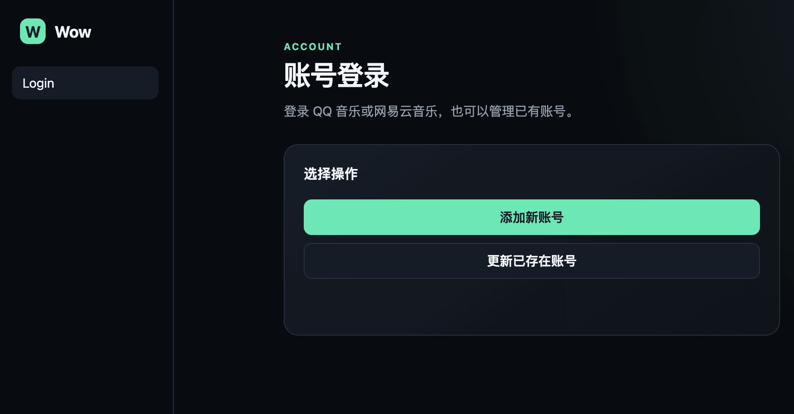
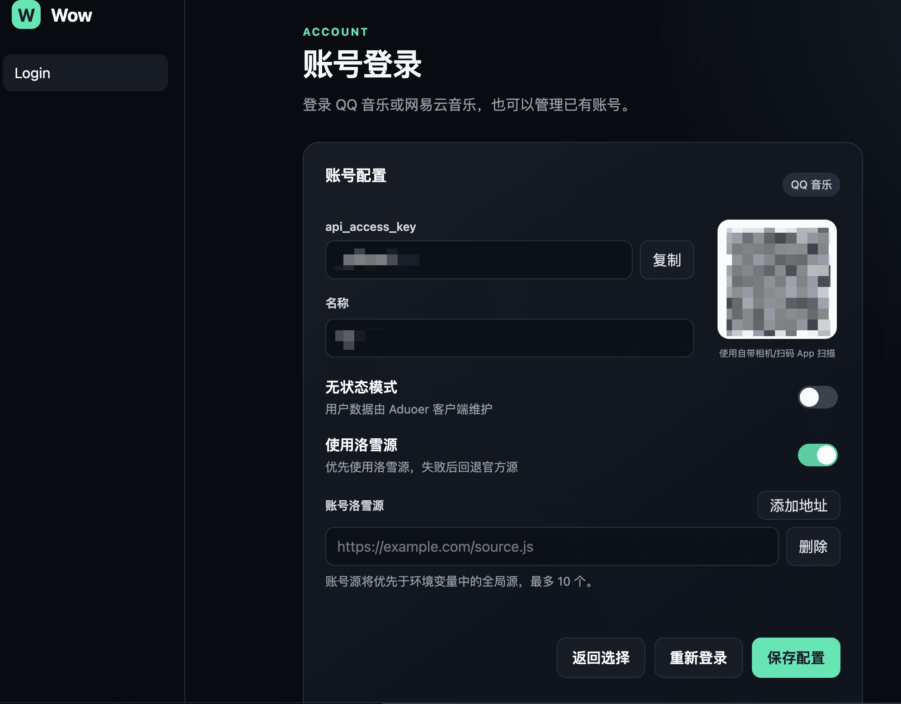

# Aduoer Wow Origin

面向 [Aduoer](https://github.com/Aduoer-Music) 的 QQ 音乐、网易云音乐、YouTube Music 统一 Wow v1 音源服务，支持搜索、歌单、榜单、歌曲、歌手、专辑、歌词和播放地址。

本项目与 Aduoer App 无任何关联，仅参考官方 Wow 模板和 SDK，提供开源实现解决方案，让用户可以在其他 App 上使用自己的订阅服务  
使用本项目前，确保你拥有对应平台的使用权限，包括但不限于，账号、订阅、已购歌曲等，否则将无法正常使用

## 截图



## 部署

| 方式 | 适合场景 | 说明 |
| --- | --- | --- |
| Cloudflare Workers | 推荐，大多数用户 | 免费起步，无需服务器、Docker 或外部数据库 |
| EdgeOne Makers | 腾讯云用户、国内访问 | Cloud Functions + Blob 持久化，需 EdgeOne 账号 |
| Docker | 有服务器、Nas 用户 | 功能完整 |
| 桌面版 | 无服务器用户 | 开箱即用，自带运行环境 |
| QX、Loon 重写 | - | 仅提供基本能力（QQ、Netease），无落雪源 |

部署成功后，访问 `http://<your-server>:<port>/login` 配置账号

### 使用 AI 部署
将以下文案复制并发给 AI
``` text
参考 [https://github.com/Anomi-oo/wow-origin] 这个项目，帮我部署一个 Wow 音乐源服务。
在部署前，你需要向我确认几个问题：
1. 使用 Cloudflare Workers、EdgeOne Makers 还是 Docker 部署？
2. 需要添加洛雪源吗？如果需要，请提供洛雪源地址
3. 如果是 Docker 部署，请提供 ssh 连接信息，或提供安装部署，我依次执行命令
4. 如果是 Cloudflare Workers 部署，请提供 Cloudflare 账号或 API Token，或提供操作步骤我依次执行
5. 如果是 EdgeOne Makers 部署，请提供腾讯云 EdgeOne API Token 和项目名称，或提供操作步骤我依次执行
```

### Cloudflare Workers（推荐）

[](https://deploy.workers.cloudflare.com/?url=https://github.com/Anomi-oo/wow-origin)

点击按钮并授权即可部署。后续可在生成仓库的 **Actions → Sync upstream → Run workflow** 中手动同步上游，Cloudflare 会自动重新部署；同步不会修改 Cloudflare 环境变量和账号数据。

如需洛雪源，在部署页面的构建变量中设置：

```text
CF_LX_SOURCE_URL=https://example.com/source.js
```

Cloudflare 版只支持一个全局洛雪源。脚本会在构建时下载并编译进 Worker；更新源后需要重新部署

### EdgeOne Makers

适用于腾讯云 EdgeOne Makers（原 EdgeOne Pages）：静态页面 + Cloud Functions（Node.js 20）+ EdgeOne Blob。账号数据和二维码/手机登录的临时状态都保存在 Blob，不依赖函数本地磁盘。

部署有两种方式：控制台关联 Git 仓库自动部署，或在本地用 CLI 推送。

#### 通过 Git 仓库自动部署（推荐）

1. 在 EdgeOne Pages 控制台新建项目，选择从 Git 仓库导入，绑定本仓库并指定 `main` 分支。
2. 构建参数全部来自仓库中的 `edgeone.json`，控制台无需重复填写：

| 配置 | 值 | 说明 |
| --- | --- | --- |
| 安装命令 | `npm install --include=dev` | 需要 devDependencies 中的 esbuild |
| 构建命令 | `npm run edgeone:build` | 生成 `cloud-functions/[[default]].js` |
| 输出目录 | `public` | 登录页等静态资源 |
| Node 版本 | `22.11.0` | 云函数运行时 |

3. 推送 `main` 即触发构建与部署，构建日志和函数日志都可以在控制台查看。

仓库中的 `cloud-functions/README.md` 是必需的占位文件：平台在生成构建计划时先判断 `cloud-functions/` 目录是否非空，再决定是否打包 Node 云函数，这个检查早于构建命令执行。缺少占位文件时项目会被当成纯静态站点，线上接口全部返回 404。

#### 本地构建与部署

先安装并登录 CLI：

```bash
npm install -g edgeone
edgeone login
```

账号默认保存在名为 `wow-origin` 的 Blob Store 中（也可用 `EDGEONE_BLOB_STORE` 指定其他名称）。Blob 命名空间会在首次 `getStore()` 时自动创建，无需在控制台手动准备。构建变量中可设置：

```text
EDGEONE_LX_SOURCE_URL=https://example.com/source.js
```

本地构建并启动：

```bash
npm run edgeone:build
edgeone makers link   # 可选：关联项目，同步控制台环境变量
edgeone makers dev
```

本地入口是 `http://localhost:8088/`（端口被占用时会自动顺延）。`edgeone.json` 的 `devCommand` 只启动一个静态回退服务，登录页、`app.js` 和 `styles.css` 由云函数直接返回，因此本地和线上行为一致。没有 Blob 凭据时账号会回退到 `data/edgeone-accounts.json`，便于离线调试。

部署：

```bash
npm run edgeone:build
edgeone makers deploy -n <project-name> -e production
```

运行时环境变量通过控制台或 `edgeone makers env set KEY VALUE` 配置，至少建议设置 `ADMIN_MANAGEMENT_PASSWORD`：

```bash
edgeone makers env set ADMIN_MANAGEMENT_PASSWORD '<password>'
```

EdgeOne 版和 Cloudflare 版一样只支持构建时内联的单个全局洛雪源，账号级洛雪源不可用。

说明与限制：

- 定时任务每天 01:00 刷新网易云登录态；QQ 登录态仍在 v1 请求前按小时检查。
- 账号按 `api_access_key` 分别写入独立的 Blob key，不同实例同时增删不同账号不会互相覆盖。写请求在响应发送前 flush；新 `api_access_key` 首次请求会强制同步，其他实例的账号更新/删除通常在一个 30 秒同步周期内生效。
- Cloud Functions 单次请求最长 120 秒、请求/响应体上限 6 MB，YouTube Music 音频代理可能因曲目过大或过长被截断；其他平台的元数据/播放地址接口不受影响。
- Blob 不可用时账号会回退到本地文件或内存，此时多实例之间不会同步；生产环境可设置 `EDGEONE_REQUIRE_BLOB=1` 让配置错误直接失败。
- 云函数运行时没有 `node_modules`，`express` 等依赖由构建脚本整包打进产物；产物里不能残留 `require('express')` 之类的运行时依赖，否则请求会返回 500。
- 仓库自带的 `Sync upstream` 工作流会用上游仓库的内容整体替换工作区，执行后会覆盖本节的 EdgeOne 相关文件，需要时请先备份。

### Docker

```bash
mkdir -p data
docker run -d \
  --name aduoer-wow \
  -p 3000:3000 \
  --env-file .env \
  -v "$(pwd)/data:/app/data" \
  --restart unless-stopped \
  anomioo/wow-origin:latest
```

如果不需要环境变量，可去掉 `--env-file .env`。使用 Compose 时可直接下载配置和环境变量模板：

```bash
mkdir wow-origin && cd wow-origin
wget -O docker-compose.yml https://raw.githubusercontent.com/Anomi-oo/wow-origin/main/docker-compose.yml
wget -O .env https://raw.githubusercontent.com/Anomi-oo/wow-origin/main/docker.env.example
mkdir -p data
docker compose up -d
```

服务地址为 `http://localhost:3000`，账号管理页面为 `http://localhost:3000/login`，数据保存在 `data/`。

### 桌面版

从 [GitHub Releases](https://github.com/Anomi-oo/wow-origin/releases) 下载 Windows x64 安装包或 Apple Silicon macOS DMG。应用默认监听 `23231`，实际地址和 Aduoer 添加二维码会显示在首页。

关闭窗口后服务仍在托盘运行。macOS 若提示应用已损坏，将应用移入“应用程序”后执行：

```bash
xattr -d com.apple.quarantine /Applications/Wow.app
```

### Quantumult X / Loon 等重写方案

该版本通过请求重写直接提供 Wow SDK 和账号接口，不需要 HTTP Backend、BoxJS、Node.js 或服务器；不包含洛雪源、扫码登录及完整服务端能力。

- [一键导入 Quantumult X](https://quantumult.app/x/open-app/add-resource?remote-resource=%7B%22rewrite_remote%22%3A%5B%22https%3A%2F%2Fraw.githubusercontent.com%2FAnomi-oo%2Fwow-origin%2Fmain%2Frewrite%2Fresources%2Fwow-origin.quantumultx.snippet%2C%20tag%3DWow%20Origin%2C%20enabled%3Dtrue%22%5D%7D)
- 复制导入到 Loon
```
loon://import?plugin=https%3A%2F%2Fraw.githubusercontent.com%2FAnomi-oo%2Fwow-origin%2Fmain%2Frewrite%2Fresources%2Fwow-origin.loon.plugin
```

导入后启用 MitM，并安装、信任代理工具的证书。访问 QQ 音乐或网易云音乐触发 Cookie 捕获后，打开以下任一地址管理账号：
[https://pinhaoge.xyz](https://pinhaoge.xyz)

Aduoer 中填写同一地址，并使用页面生成的 Token

## 配置

| 变量 | 默认值 | 说明 |
| --- | --- | --- |
| `ADMIN_MANAGEMENT_PASSWORD` | 空 | 网页管理员密钥；Docker / Node 环境变量或 Cloudflare 运行时 Secret |
| `PORT` | `3000` | 服务端口 |
| `HOST` | `0.0.0.0` | 监听地址 |
| `LOG_LEVEL` | `info` | 日志级别 |
| `CORS_ALLOW_ORIGIN` | `*` | 允许访问的来源 |
| `LX_SOURCE_URL` | 空 | Node、Docker、桌面版的主洛雪源 |
| `LX_SOURCE_URL0`…`LX_SOURCE_URL9` | 空 | 备用洛雪源，按编号尝试 |
| `CF_LX_SOURCE_URL` | 空 | Cloudflare 构建时使用的全局洛雪源 |
| `EDGEONE_LX_SOURCE_URL` | 空 | EdgeOne 构建时使用的全局洛雪源（也兼容 `CF_LX_SOURCE_URL`） |
| `EDGEONE_BLOB_STORE` | `wow-origin` | EdgeOne Blob store 名称 |
| `EDGEONE_REQUIRE_BLOB` | `0` | 为 `1` 时 Blob 不可用直接失败，不回退本地文件 |

洛雪源仅用于音频获取（`/v1/track/url`）。自定义源会作为受信任代码运行，请勿配置未经审核的脚本。

### 账号管理

配置 `ADMIN_MANAGEMENT_PASSWORD` 后，网页右上角会显示“管理员模式”。输入密钥后可查看和管理全部账号，刷新或关闭页面后需重新验证；也可点击退出。未配置或值为空时无法进入。桌面版默认具有全部账号管理能力，无需管理员密码。

Docker 在 `.env` 中填写此变量并重建容器（`docker compose up -d --force-recreate`）。Cloudflare 在 Worker 的 **Settings → Variables and Secrets** 中添加同名 Secret 并部署，或运行 `npx wrangler secret put ADMIN_MANAGEMENT_PASSWORD`。这是运行时密钥，不是洛雪源构建变量；本地 Wrangler 开发可写入 `.dev.vars`。

管理员和通过账号 `api_access_key` 登录的用户均可在账号配置页删除该账号。二次确认后会永久删除本服务的数据库记录并清理内存中的账号状态，原音乐平台账号不受影响，旧访问密钥立即失效。

Node / Docker / 桌面启动时会清理旧的 `data/accounts.json`：首次成功导入数据库后删除；已有数据库以数据库为准。迁移失败时保留旧文件并报告错误，避免丢失数据。

## 开发

需要 Node.js 22 或更高版本。

```bash
npm ci
npm run dev
npm run typecheck
npm test
```

其他构建命令：

```bash
npm run cloudflare:typecheck
npm run cloudflare:deploy
npm run edgeone:typecheck
npm run edgeone:build
npm run desktop:build
npm run rewrite:typecheck
```

Rewrite 的单文件页面位于 `rewrite/ui/index.html`，QuanX 和 Loon 配置位于 `rewrite/resources/`。

## 安全说明

- 不要公开 Cookie、数据库、`.env`、`api_access_key` 或私有洛雪源地址。
- Docker 构建不会包含本地 `data/` 和 `.env`。
- 若凭据曾进入公开仓库或日志，请立即刷新凭据并清理 Git 历史。

## 致谢

本项目基于 [Aduoer-Music/aduoer-wow-template](https://github.com/Aduoer-Music/aduoer-wow-template)，并参考了以下项目：

- [tlyanyu/multiPlatformMusicApi](https://github.com/tlyanyu/multiPlatformMusicApi)
- [neteasecloudmusicapienhanced/api-enhanced](https://github.com/neteasecloudmusicapienhanced/api-enhanced)
- [jsososo/QQMusicApi](https://github.com/jsososo/QQMusicApi)
- [lyswhut/lx-music-desktop](https://github.com/lyswhut/lx-music-desktop)
- [ytmusicapi](https://github.com/sigma67/ytmusicapi)

## 许可与免责声明

项目采用 [MIT License](LICENSE)，仅供学习与交流。使用者应遵守所在地法律、平台服务条款及内容版权要求，并自行承担使用后果。
